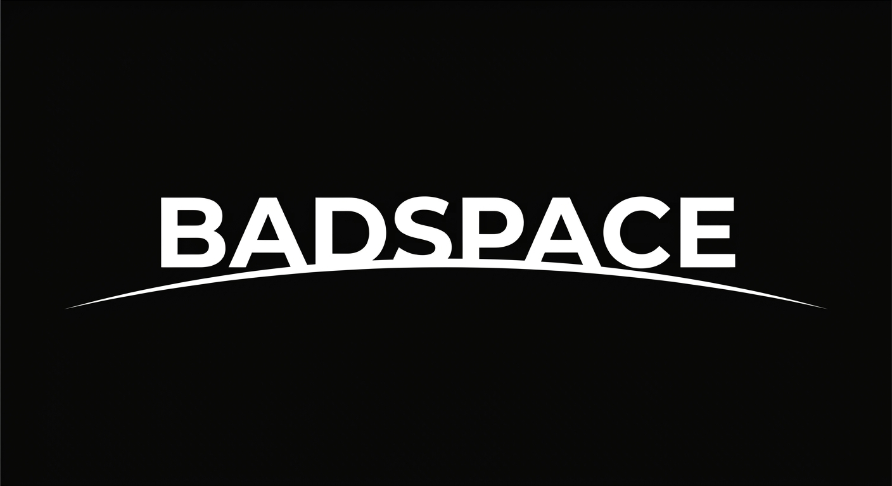

[English](README.md)

BADSPACE sarà un database real-time per entità in uno spazio 2D o 3D, pensato come base per software di simulazione, monitoraggio o gaming. Terrà traccia della posizione delle entità e risponderà a query di prossimità (range, k-nearest, raycasting) mentre migliaia di entità si muovono a ogni tick. Scalerà dividendo il mondo in partizioni che si creano e si rimuovono dinamicamente, ognuna con un solo writer.

L'obiettivo è uno strumento flessibile, che i programmatori adatteranno alle proprie esigenze invece di usarlo così com'è. Si potrà usare come libreria o come servizio, scegliere strategie di partizionamento e di clustering, e costruire sopra le sue API la propria logica applicativa. BADSPACE sarà pensato per chi non cerca un servizio già pronto, ma gli strumenti per costruire la propria soluzione.

Il progetto è in fase prototipale: il prototipo in Java (`prototype/`) serve a validare le decisioni di progetto, documentate nel [bundle OKF](okf-bundle/index.md). Stato attuale:

- **Fatto:** libreria embedded con spazi 2D e 3D, partizioni su nodi locali, indici spaziali scelti alla creazione della partizione, inserimento, lettura, aggiornamento e rimozione delle entità.
- **In corso:** commit della partizione, con un writer e più reader concorrenti sulla stessa partizione.

## Checkout

Il repository contiene un link simbolico: `.claude/skills` punta a `.agents/skills`. Su Linux e macOS git lo crea senza passaggi aggiuntivi.

Su Windows git crea i link simbolici solo se `core.symlinks` vale `true` e l'utente ha il permesso di crearli (Developer Mode attiva, oppure una shell avviata come amministratore). Altrimenti git scrive un file di testo con il percorso di destinazione, e le skill non vengono trovate. Per clonare il repository con i link simbolici abilitati:

```bash
git clone -c core.symlinks=true git@github.com:siculo/badspace.git
```

Se il repository è già clonato, abilitare l'opzione e ripristinare il link:

```bash
git config core.symlinks true
git checkout -- .claude/skills
```

Se non è possibile attivare la Developer Mode né usare una shell da amministratore, si può creare al suo posto una junction di directory, che non richiede permessi particolari. Da `cmd`, nella radice del repository:

```cmd
del .claude\skills
mklink /J .claude\skills .agents\skills
git update-index --skip-worktree .claude/skills
```

Avvertenze sulla junction:

- `del` cancella il file di testo che git ha scritto al posto del link.
- Windows salva la destinazione della junction come percorso assoluto: se si sposta il repository, la junction va ricreata.
- Git si aspetta ancora un file di testo in `.claude/skills`. Il flag `skip-worktree` evita che git lo mostri come modificato, così un `git add -A` non committa il contenuto delle skill al posto del link. Se un commit futuro cambia il link, eseguire `git update-index --no-skip-worktree .claude/skills` prima del pull.
- Questa configurazione non è ancora stata provata con Claude Code su Windows.

Licenza: [Apache 2.0](LICENSE).
