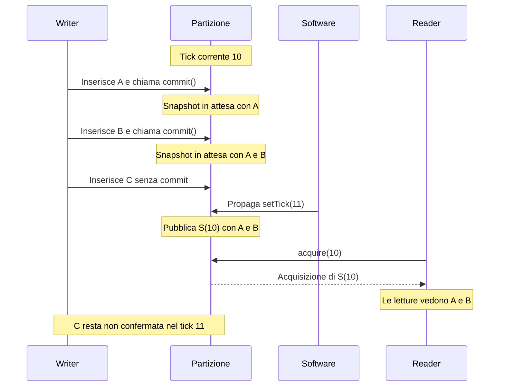

# Primitiva

Le scritture del writer sono confermate da **commit**: ogni commit è
una transazione limitata alla partizione. I lettori vedono solo stati
confermati, mai uno stato intermedio. La conferma non scrive su disco: il salvataggio
è un’operazione separata.

Non esistono transazioni tra partizioni. Con un solo writer (vedi
[proprietà della partizione](/current/architecture/partition-ownership.md)) il
commit non richiede gestione dei conflitti tra writer né abort per
concorrenza. Il lock della partizione lo ordina rispetto all’avanzamento
del tick e ai cambi di proprietà.

# Commit e tick

Il commit **avviene in un [tick](/current/architecture/logical-time.md)** e non
ha un numero visibile: `commit()` conferma le scritture fatte fino a
quel momento e usa il tick corrente della partizione.

- **Più commit nello stesso tick** sono ammessi: l'ultimo commit del
  tick definisce lo snapshot `S(T)` del tick.
- **Senza commit** durante il tick T, `S(T)` ha lo stesso stato dello
  snapshot precedente.
- **Le scritture non confermate** a fine tick restano nello stato del
  writer e passano al tick successivo: un writer può impiegare più tick
  per completarle, e le conferma con il commit di un tick successivo.
  Non entrano mai in uno snapshot finché non sono confermate.
- **Visibilità.** `S(T)` diventa acquisibile solo all'avanzamento del
  tick, non alla fine del commit (vedi [conservazione degli
  snapshot](/current/architecture/snapshot-retention.md#commit-e-tick)). Un commit
  concorrente all'avanzamento è ordinato rispetto a esso: finisce nel
  tick che si chiude o in quello nuovo, e non cambia mai uno snapshot già
  pubblicato.

Il commit conferma lo **stato cumulativo** del writer: non azzera le
scritture già confermate. Con più commit nello stesso tick, l’ultimo
include anche gli effetti dei precedenti, salvo le successive modifiche
o rimozioni. I reader vedono solo lo stato dell’ultimo commit del tick,
non gli stati intermedi dei singoli commit.

Per esempio, nel tick 10 il writer inserisce A e fa commit, poi
inserisce B e fa un secondo commit. Dopo `setTick(11)`, `S(10)` contiene
A e B. Se prima dell’avanzamento inserisce anche C senza un altro
commit, C resta nello stato del writer ma non entra in `S(10)`.

Il diagramma riprende l’esempio su una singola partizione. Le chiamate
del writer passano dal suo handle; la propagazione di `Space.setTick(11)`
attraverso il nodo è riassunta nella freccia di avanzamento.

`commit()` non fa avanzare il tick, non attende il tick successivo e
non impedisce nuove scritture nello stesso tick. È il software del
writer a scegliere quando fare commit e se attendere il tick successivo
prima di continuare. Se scrive e conferma in continuazione, per ogni
tick i reader possono acquisire solo lo stato dell’ultimo commit.

Nel caso tipico di un server a frame il writer fa un commit per tick.
Un uso a batch, per esempio per dati di posizione aggiornati a
intervalli, è lo stesso schema con un tempo di scrittura più lungo: il
writer distribuisce le scritture del batch su più tick e chiama
`commit()` alla fine; i tick senza commit ripetono lo stato precedente.

Lo stato confermato si salva con un’operazione di
[persistenza](/current/decisions/persistence.md), dopo la pubblicazione.

## Sequenza dei commit

Gli indici copy-on-write hanno comunque bisogno di distinguere un commit
dal successivo, anche dentro lo stesso tick: usano un contatore interno
a ogni partizione, la **sequenza dei commit**, che non esce dal nodo (vedi [isolamento
delle letture](/current/decisions/read-isolation.md#gli-indici)).

# Nel prototipo

Il commit si chiude con `commit()`, senza numero (vedi [API da
esporre](/current/api/operations.md#commit)). Al commit lo storage
produce lo snapshot della partizione, con lo snapshot degli slot e
quello dell'indice, che le scritture successive non cambiano, e lo
tiene in attesa: lo pubblica l'avanzamento del tick, e un commit
successivo nello stesso tick lo sostituisce (vedi [conservazione degli
snapshot](/current/architecture/snapshot-retention.md#nel-prototipo)). Ogni
commit ha un numero nella sequenza dei commit, interno allo storage,
che va a `commit(n)` degli indici. I lettori leggono lo snapshot
attraverso un'[acquisizione](/current/architecture/snapshot-retention.md#acquisizione-e-rilascio),
e vedono solo commit completi. Anche il writer legge così: non
interroga il proprio stato non confermato (vedi
[letture](/current/api/operations.md#letture)). Lo storage non ha letture
dello stato del writer: chi deve leggere quello che ha scritto lo fa sugli
snapshot, e nei test si confermano le scritture e si avanza il tick.

# Correlati

- [Architettura minima](/current/architecture/minimal-core.md) — ruolo nel nucleo corrente.
- [Tick logico](/current/architecture/logical-time.md) — il tick in cui avviene
  il commit.
- [Isolamento delle letture](/current/decisions/read-isolation.md) — ogni commit
  prepara uno snapshot che i lettori leggono senza lock.
- I [metadati delle entità](/current/architecture/entity-metadata.md) cambiano
  nello stesso commit dei dati.
