```mermaid
block-beta
    columns 16
    tick10["Tick 10"] space:3 tick11["Tick 11"] space:3 tick12["Tick 12"] space commitBatch["Commit"] space tick13["Tick 13"] space:3
    start10((" ")) space:3 start11((" ")) space:3 start12((" ")) space pointBatch((" ")) space start13((" ")) space:2 axisEnd[" "]
    space writeBatch["Scritture del batch A"]:9 space:6
    snapshot9["S(9)<br/>vuoto"] space:3 snapshot10["S(10)<br/>vuoto"] space:3 snapshot11["S(11)<br/>vuoto"] space:3 snapshot12["S(12)<br/>batch A"] space:3
    start10 --- start11
    start11 --- start12
    start12 --- pointBatch
    pointBatch --- start13
    start13 --> axisEnd
    commitBatch --> pointBatch
    tick10 --- start10
    tick11 --- start11
    tick12 --- start12
    tick13 --- start13
    start10 -.-> snapshot9
    start11 -.-> snapshot10
    start12 -.-> snapshot11
    start13 -.-> snapshot12
    classDef label fill:none,stroke:none,color:#222
    classDef point fill:#222,stroke:#222
    classDef write fill:#e8f0ff,stroke:#5276b5
    classDef snapshot fill:#eaf5ec,stroke:#54815c
    class tick10,tick11,tick12,tick13,commitBatch,axisEnd label
    class start10,start11,start12,start13,pointBatch point
    class writeBatch write
    class snapshot9,snapshot10,snapshot11,snapshot12 snapshot
```

# Primitiva

`commit()` conferma lo stato completo del writer di una partizione,
con le posizioni e i metadati delle entità. È una transazione limitata alla
partizione; il [salvataggio su disco](/current/decisions/persistence.md)
è un’operazione separata.

# Commit e tick

Il commit prepara lo stato del [tick](/current/architecture/logical-time.md)
corrente T. Lo snapshot `S(T)` diventa acquisibile solo quando il tick
della partizione avanza oltre T. I tre diagrammi mostrano come questa
regola si applica a frequenze diverse di scrittura e commit.

## Esempio temporale su più tick

Il tempo procede **da sinistra a destra**. I segni verticali delimitano
i tick; le frecce dall’alto indicano commit completati. Le barre azzurre
mostrano gli intervalli di scrittura; i riquadri verdi gli snapshot che
diventano acquisibili al confine indicato dalla linea tratteggiata.

Le distanze sono illustrative e la durata interna del commit non è
mostrata. Ogni esempio parte da `S(9)` vuoto, con lo stesso proprietario
per tutta la durata. A, B e C sono entità; nell’ultimo esempio A indica
un batch di scritture.

### Un commit e un commit senza nuove scritture

Il commit di A nel tick 10 prepara `S(10)`, visibile dall’inizio del
tick 11. Il commit senza nuove scritture nel tick 11 è valido e produce
`S(11)` con lo stesso contenuto, visibile dal tick 12.

```mermaid
block-beta
    columns 12
    tick10["Tick 10"] space:2 commitA["Commit A"] tick11["Tick 11"] space:2 commitSame["Commit"] tick12["Tick 12"] space:3
    start10((" ")) space:2 pointA((" ")) start11((" ")) space:2 pointSame((" ")) start12((" ")) space:2 axisEnd[" "]
    space writeA["Scritture A"]:2 space:9
    snapshot9["S(9)<br/>vuoto"] space:3 snapshot10["S(10)<br/>con A"] space:3 snapshot11["S(11)<br/>con A"] space:3
    start10 --- pointA
    pointA --- start11
    start11 --- pointSame
    pointSame --- start12
    start12 --> axisEnd
    commitA --> pointA
    commitSame --> pointSame
    tick10 --- start10
    tick11 --- start11
    tick12 --- start12
    start10 -.-> snapshot9
    start11 -.-> snapshot10
    start12 -.-> snapshot11
    classDef label fill:none,stroke:none,color:#222
    classDef point fill:#222,stroke:#222
    classDef write fill:#e8f0ff,stroke:#5276b5
    classDef snapshot fill:#eaf5ec,stroke:#54815c
    class tick10,tick11,tick12,commitA,commitSame,axisEnd label
    class start10,start11,start12,pointA,pointSame point
    class writeA write
    class snapshot9,snapshot10,snapshot11 snapshot
```

### Più commit nello stesso tick

I commit sono cumulativi: il secondo conserva A e aggiunge B. Solo il
contenuto dell’ultimo commit del tick diventa acquisibile. C, scritta
dopo quel commit, resta non confermata fino al commit del tick 11.

```mermaid
block-beta
    columns 15
    tick10["Tick 10"] space commitA["Commit"] space commitAB["Commit"] space tick11["Tick 11"] space:2 commitABC["Commit"] space:2 tick12["Tick 12"] space:2
    start10((" ")) space pointA((" ")) space pointAB((" ")) space start11((" ")) space:2 pointABC((" ")) space:2 start12((" ")) space axisEnd[" "]
    space writeA["Scritture A"] space writeB["Scritture B"] space writeC["Scritture C"] space:9
    snapshot9["S(9)<br/>vuoto"] space:5 snapshot10["S(10)<br/>A e B"] space:5 snapshot11["S(11)<br/>A, B e C"] space:2
    start10 --- pointA
    pointA --- pointAB
    pointAB --- start11
    start11 --- pointABC
    pointABC --- start12
    start12 --> axisEnd
    commitA --> pointA
    commitAB --> pointAB
    commitABC --> pointABC
    tick10 --- start10
    tick11 --- start11
    tick12 --- start12
    start10 -.-> snapshot9
    start11 -.-> snapshot10
    start12 -.-> snapshot11
    classDef label fill:none,stroke:none,color:#222
    classDef point fill:#222,stroke:#222
    classDef write fill:#e8f0ff,stroke:#5276b5
    classDef snapshot fill:#eaf5ec,stroke:#54815c
    class tick10,tick11,tick12,commitA,commitAB,commitABC,axisEnd label
    class start10,start11,start12,pointA,pointAB,pointABC point
    class writeA,writeB,writeC write
    class snapshot9,snapshot10,snapshot11 snapshot
```

### Scritture su più tick prima del commit

Il writer completa il batch A nel tick 12. Nei tick 10 e 11 non fa
commit: i loro snapshot ripetono il contenuto precedente. Le scritture
restano nello stato del writer e diventano visibili insieme in `S(12)`,
dal tick 13.

La barra lunga rappresenta una serie di scritture, non una singola
chiamata che trattiene il lock durante gli avanzamenti del tick.

## Regole d’uso

Il software decide quando chiamare `commit()` e se attendere il tick
successivo prima di continuare. La chiamata non avanza il tick, non
attende il successivo e permette altre scritture e commit nello stesso
tick. Un server a frame può fare un commit per tick; un’elaborazione a
batch può distribuirsi su più tick, come nell’ultimo diagramma.

Tutti leggono attraverso snapshot pubblicati e
[acquisiti](/current/architecture/snapshot-retention.md#acquisizione-e-rilascio),
anche il writer: il commit non gli dà accesso al proprio stato ancora
in attesa. Ogni acquisizione vede un commit completo, mai uno stato
intermedio. Gli snapshot precedenti restano acquisibili finché sono nella
finestra di conservazione. Snapshot logici con lo stesso contenuto
possono condividerlo, senza una copia per ogni tick.

Il lock della partizione ordina commit, avanzamento del tick e cambi
di proprietà. Un commit concorrente all’avanzamento appartiene al tick
che si chiude oppure a quello nuovo; non modifica uno snapshot già
pubblicato. Non ci sono transazioni tra partizioni né conflitti tra
writer validi della stessa partizione: la
[proprietà](/current/architecture/partition-ownership.md) ne ammette uno solo.

Se cambia il proprietario nello stesso tick, il successore conserva i
commit precedenti senza poterli ancora leggere. Il limite è descritto
nella [visibilità nel tick del passaggio](/current/architecture/partition-ownership.md#visibilità-nel-tick-del-passaggio).

## Sequenza dei commit

`commit()` non riceve né restituisce un numero di commit. Gli indici
copy-on-write distinguono però i commit con una **sequenza interna alla
partizione**, che cresce anche con più commit nello stesso tick. Il
contatore non esce dal nodo e non è condiviso tra partizioni.

# Nel prototipo

Lo storage prepara uno snapshot di slot, indice e metadati al commit;
un commit successivo nello stesso tick lo sostituisce. L’avanzamento
pubblica il nuovo catalogo degli snapshot con una scrittura atomica.
`commit(n)` degli indici usa la sequenza interna descritta sopra.
Per strutture e garanzie, vedere
[isolamento delle letture](/current/decisions/read-isolation.md) e
[conservazione degli snapshot](/current/architecture/snapshot-retention.md#nel-prototipo).

# Correlati

- [Nucleo delle partizioni](/current/architecture/minimal-core.md) — garanzie del livello base.
- [Tick logico](/current/architecture/logical-time.md) — avanzamento e pubblicazione.
- [Metadati applicativi](/current/architecture/entity-metadata.md) — confermati insieme alle posizioni.
- [Contratto dell’API](/current/api/operations.md#commit) — chiamata ed errori.
